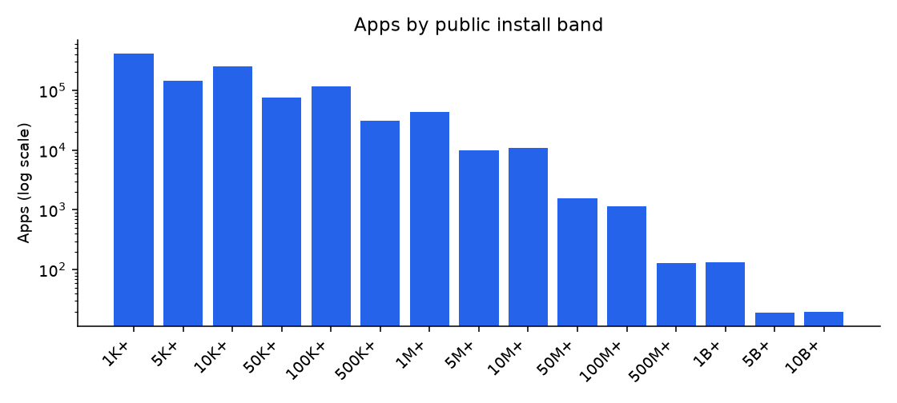
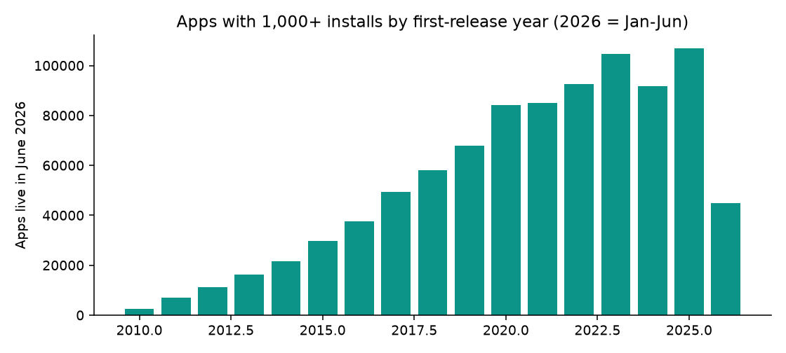
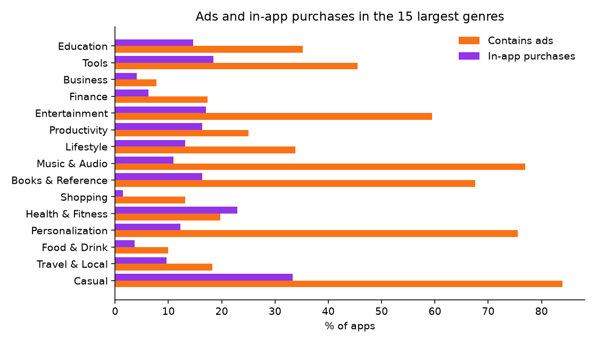

# Google Play Apps 2026 (1.1M apps, 1K+ installs): findings, method and data card

*Fliar Research · released October 2026 · licence CC BY-NC 4.0*

**How this dataset was acquired.** Every row comes from the [Radar API](https://github.com/fliarbi/radar-api-mcp), Fliar's company-data API and MCP server. Radar crawls
the public Google Play store page of every app it can discover (2.94 million apps in the June 2026 crawl, read from the US storefront)
and stores each listing's title, developer, genre, install band, ratings, price, ads and in-app purchase labels and dates. This release
keeps the 1.1 million apps with at least 1,000 installs. It normalises dates to YYYY-MM-DD, reduces each developer website to its
registered domain (so apps can be joined to companies), and removes all developer contact details. The full data, including exact
install counts and install growth, is available through `POST /v1/apps/profile` ([reference](https://github.com/fliarbi/radar-api-mcp/blob/main/docs/reference/get_app.md)) or the `get_app` MCP tool;
`POST /v1/companies/apps` lists every app of a company by its domain.

> **This file is a 9% sample: 100,013 of 1,101,050 apps.** It keeps every record for a fixed subset of developers.
> The subset is chosen by a hash, so it stays the same from one release to the next. The findings and tables below were computed
> on the **full** data. For the rest, the withheld fields and monthly updates, [get a Radar API key](https://fliarbi.com/radar-api/developer) ([docs](https://github.com/fliarbi/radar-api-mcp)).
> Each row's `fliar_profile_url` opens the company's full profile on Fliar.

## Full dataset on request

This release publishes about **100,000 apps**. The **complete dataset of 1.1 million apps** (every app with 1,000+ installs, with the same
columns) is available **on request** for research, journalism and other fair use.

- **Email** [b2b@fliarbi.com](mailto:b2b@fliarbi.com) with your name, organisation and a short description of how you will use the data, or
- use the **[Fliar contact page](https://fliarbi.com/contact)**.

Exact install counts, install growth and install history are not part of the request dataset; they come from the
[Radar API](https://github.com/fliarbi/radar-api-mcp).

## Key findings

1. **1,101,050 apps from 449,255 developers have 1,000 or more installs.** 66,992 of them (6.1%) have passed 1 million installs, and 171 have passed 1 billion.
2. **Most apps stay small.** 51% sit in the 1,000+ or 5,000+ bands; only 19.6% reach 100,000+.
3. **Games are 15% of apps but 39% of the million-install club.** Education is the largest genre (119,589 apps).
4. **Ads are the default business model.** 43% of apps show ads and 18% sell in-app purchases; only 1.4% charge to install. Among apps with 1M+ installs, 71% show ads and 51% sell in-app items.
5. **Rated apps average 4.01 stars** (median 4.2). 62% of rated apps score 4.0 or higher; 10% score below 3.0.
6. **Maintenance splits the store.** 46% of apps were updated in 2026 (up to the June crawl), while 11% have not been updated since before 2024.

### All 48 genres

Full data, apps with 1,000+ installs. Ratings are medians over apps that show a rating.

| Genre                   | Apps    | Share of apps   | Developers   | Apps with 1M+ installs   | Median rating   | Rated 4.0+   | Contain ads   | In-app purchases   | Paid   | Updated in 2026   |
|:------------------------|:--------|:----------------|:-------------|:-------------------------|:----------------|:-------------|:--------------|:-------------------|:-------|:------------------|
| Education               | 119,589 | 10.9%           | 47,850       | 2,407                    | 4.33            | 70.2%        | 35.2%         | 14.6%              | 0.8%   | 42.8%             |
| Tools                   | 90,113  | 8.2%            | 53,669       | 6,372                    | 4.00            | 51.3%        | 45.5%         | 18.4%              | 1.2%   | 44.6%             |
| Business                | 69,085  | 6.3%            | 47,420       | 1,176                    | 3.86            | 45.3%        | 7.8%          | 4.0%               | 0.2%   | 53.4%             |
| Finance                 | 56,624  | 5.1%            | 38,931       | 3,426                    | 4.23            | 63.7%        | 17.4%         | 6.2%               | 0.2%   | 62.8%             |
| Entertainment           | 55,138  | 5.0%            | 30,220       | 3,788                    | 4.10            | 56.7%        | 59.5%         | 17.0%              | 0.6%   | 42.2%             |
| Productivity            | 51,353  | 4.7%            | 35,484       | 2,153                    | 4.05            | 54.4%        | 25.1%         | 16.3%              | 1.0%   | 50.5%             |
| Lifestyle               | 50,698  | 4.6%            | 30,630       | 1,814                    | 4.32            | 66.5%        | 33.8%         | 13.2%              | 0.6%   | 46.5%             |
| Music & Audio           | 47,438  | 4.3%            | 13,073       | 1,684                    | 4.43            | 75.2%        | 76.9%         | 11.0%              | 0.9%   | 31.6%             |
| Books & Reference       | 43,582  | 4.0%            | 13,015       | 1,155                    | 4.56            | 82.7%        | 67.6%         | 16.3%              | 1.0%   | 32.2%             |
| Shopping                | 42,874  | 3.9%            | 28,861       | 1,969                    | 4.33            | 67.4%        | 13.1%         | 1.4%               | 0.0%   | 52.1%             |
| Health & Fitness        | 36,728  | 3.3%            | 23,442       | 1,272                    | 4.17            | 59.2%        | 19.7%         | 22.9%              | 0.8%   | 52.7%             |
| Personalization         | 36,109  | 3.3%            | 6,941        | 1,902                    | 4.46            | 81.3%        | 75.5%         | 12.2%              | 13.6%  | 25.9%             |
| Food & Drink            | 34,503  | 3.1%            | 14,568       | 711                      | 4.29            | 63.5%        | 10.0%         | 3.7%               | 0.1%   | 41.5%             |
| Travel & Local          | 32,656  | 3.0%            | 19,657       | 1,096                    | 4.05            | 54.2%        | 18.2%         | 9.7%               | 0.4%   | 49.2%             |
| Casual                  | 27,858  | 2.5%            | 12,006       | 3,625                    | 4.21            | 63.8%        | 83.9%         | 33.4%              | 1.0%   | 53.1%             |
| Puzzle                  | 27,846  | 2.5%            | 12,519       | 3,189                    | 4.40            | 75.7%        | 86.5%         | 49.1%              | 1.7%   | 48.8%             |
| Sports                  | 25,631  | 2.3%            | 15,430       | 1,476                    | 4.17            | 60.5%        | 45.1%         | 23.2%              | 1.0%   | 52.8%             |
| Communication           | 20,543  | 1.9%            | 13,685       | 1,291                    | 4.02            | 53.9%        | 27.3%         | 10.2%              | 0.5%   | 45.0%             |
| Simulation              | 17,135  | 1.6%            | 7,375        | 3,886                    | 4.04            | 53.8%        | 87.7%         | 49.6%              | 2.7%   | 53.3%             |
| Maps & Navigation       | 16,358  | 1.5%            | 10,286       | 804                      | 3.99            | 49.8%        | 25.0%         | 11.7%              | 0.8%   | 55.2%             |
| Medical                 | 15,748  | 1.4%            | 10,814       | 382                      | 4.10            | 56.0%        | 13.9%         | 8.6%               | 1.4%   | 49.6%             |
| Social                  | 14,424  | 1.3%            | 11,329       | 1,042                    | 4.08            | 56.1%        | 30.0%         | 28.4%              | 0.1%   | 50.4%             |
| News & Magazines        | 13,748  | 1.2%            | 7,062        | 541                      | 4.11            | 57.6%        | 66.0%         | 22.5%              | 0.1%   | 46.1%             |
| Auto & Vehicles         | 13,501  | 1.2%            | 9,439        | 379                      | 3.91            | 47.5%        | 15.5%         | 6.6%               | 0.8%   | 50.8%             |
| Photography             | 12,821  | 1.2%            | 5,585        | 1,873                    | 4.13            | 58.8%        | 76.3%         | 27.2%              | 1.4%   | 39.2%             |
| Role Playing            | 10,745  | 1.0%            | 5,000        | 1,920                    | 4.03            | 53.5%        | 65.1%         | 59.7%              | 5.3%   | 58.2%             |
| Arcade                  | 10,464  | 1.0%            | 6,442        | 1,536                    | 4.12            | 58.6%        | 77.1%         | 39.2%              | 2.7%   | 40.4%             |
| Action                  | 10,321  | 0.9%            | 5,806        | 2,371                    | 4.11            | 58.5%        | 82.8%         | 47.4%              | 3.0%   | 47.6%             |
| Educational             | 9,391   | 0.9%            | 3,975        | 1,489                    | 4.07            | 57.2%        | 59.0%         | 41.6%              | 3.3%   | 38.6%             |
| Adventure               | 8,867   | 0.8%            | 4,586        | 1,264                    | 4.20            | 64.1%        | 73.5%         | 42.5%              | 7.1%   | 42.7%             |
| House & Home            | 7,440   | 0.7%            | 5,633        | 227                      | 3.81            | 42.1%        | 19.1%         | 7.8%               | 0.2%   | 50.2%             |
| Strategy                | 7,347   | 0.7%            | 4,056        | 1,560                    | 4.03            | 53.3%        | 69.2%         | 57.1%              | 4.2%   | 57.1%             |
| Art & Design            | 6,650   | 0.6%            | 3,925        | 584                      | 4.10            | 56.7%        | 71.7%         | 31.8%              | 1.1%   | 41.4%             |
| Video Players & Editors | 6,472   | 0.6%            | 4,716        | 1,076                    | 4.02            | 52.9%        | 67.2%         | 28.8%              | 1.9%   | 46.8%             |
| Board                   | 5,976   | 0.5%            | 3,497        | 787                      | 4.32            | 71.6%        | 75.5%         | 43.2%              | 3.8%   | 45.0%             |
| Card                    | 5,921   | 0.5%            | 2,979        | 784                      | 4.31            | 71.9%        | 77.5%         | 49.0%              | 2.6%   | 48.9%             |
| Events                  | 5,178   | 0.5%            | 3,941        | 77                       | 4.17            | 59.3%        | 19.7%         | 3.8%               | 0.1%   | 47.2%             |
| Word                    | 4,593   | 0.4%            | 2,713        | 553                      | 4.49            | 81.3%        | 87.3%         | 53.8%              | 1.6%   | 43.7%             |
| Racing                  | 4,565   | 0.4%            | 2,314        | 1,150                    | 4.07            | 56.7%        | 89.3%         | 41.7%              | 1.3%   | 46.8%             |
| Trivia                  | 4,133   | 0.4%            | 2,516        | 339                      | 4.30            | 69.6%        | 84.1%         | 40.7%              | 0.8%   | 37.8%             |
| Casino                  | 3,912   | 0.4%            | 1,906        | 393                      | 4.37            | 76.3%        | 58.4%         | 34.7%              | 5.4%   | 56.3%             |
| Dating                  | 3,680   | 0.3%            | 2,546        | 295                      | 3.78            | 40.3%        | 50.1%         | 55.8%              | 0.0%   | 56.9%             |
| Beauty                  | 3,591   | 0.3%            | 2,187        | 152                      | 4.12            | 59.2%        | 31.8%         | 11.3%              | 0.2%   | 36.2%             |
| Weather                 | 3,385   | 0.3%            | 2,230        | 310                      | 4.27            | 66.5%        | 59.6%         | 23.9%              | 2.8%   | 53.7%             |
| Parenting               | 2,625   | 0.2%            | 2,176        | 200                      | 4.20            | 60.7%        | 37.4%         | 34.1%              | 0.7%   | 49.6%             |
| Music                   | 1,544   | 0.1%            | 888          | 346                      | 4.18            | 63.8%        | 79.0%         | 42.8%              | 2.3%   | 50.2%             |
| Libraries & Demo        | 1,375   | 0.1%            | 860          | 58                       | 4.23            | 62.9%        | 41.5%         | 14.3%              | 0.6%   | 40.0%             |
| Comics                  | 772     | 0.1%            | 618          | 108                      | 4.10            | 57.6%        | 59.5%         | 37.0%              | 4.0%   | 48.3%             |

### Top 50 apps by installs

Ordered by public install band, then by number of ratings.

| #   | App                            | Developer                      | Genre                   | Installs        | Rating   | Ratings     | Released   | Ads   | IAP   |
|:----|:-------------------------------|:-------------------------------|:------------------------|:----------------|:---------|:------------|:-----------|:------|:------|
| 1   | WhatsApp Messenger             | WhatsApp LLC                   | Communication           | 10,000,000,000+ | 4.67     | 236,267,833 | 2010-10    | no    | yes   |
| 2   | Facebook                       | Meta Platforms, Inc.           | Social                  | 10,000,000,000+ | 4.56     | 182,075,532 |            | yes   | yes   |
| 3   | YouTube                        | Google LLC                     | Video Players & Editors | 10,000,000,000+ | 3.87     | 170,565,557 | 2010-10    | yes   | yes   |
| 4   | Google Photos                  | Google LLC                     | Photography             | 10,000,000,000+ | 4.40     | 53,677,277  | 2015-05    | no    | no    |
| 5   | Google Chrome                  | Google LLC                     | Communication           | 10,000,000,000+ | 4.13     | 48,706,066  | 2012-02    | yes   | no    |
| 6   | Google Play services           | Google LLC                     | Tools                   | 10,000,000,000+ | 4.30     | 44,606,833  | 2012-05    | no    | no    |
| 7   | Google Messages                | Google LLC                     | Communication           | 10,000,000,000+ | 4.38     | 42,499,811  | 2014-11    | no    | no    |
| 8   | Google                         | Google LLC                     | Tools                   | 10,000,000,000+ | 4.06     | 29,210,175  | 2010-08    | yes   | no    |
| 9   | Google Maps                    | Google LLC                     | Travel & Local          | 10,000,000,000+ | 3.25     | 19,439,271  |            | yes   | no    |
| 10  | Gboard - the Google Keyboard   | Google LLC                     | Tools                   | 10,000,000,000+ | 4.52     | 18,620,449  | 2013-06    | no    | no    |
| 11  | Gmail                          | Google LLC                     | Communication           | 10,000,000,000+ | 4.08     | 14,313,998  | 2010-09    | yes   | no    |
| 12  | Google Meet                    | Google LLC                     | Communication           | 10,000,000,000+ | 4.41     | 11,866,204  | 2016-08    | no    | no    |
| 13  | Google Drive                   | Google LLC                     | Productivity            | 10,000,000,000+ | 4.28     | 10,768,556  | 2011-04    | no    | yes   |
| 14  | Android System WebView         | Google LLC                     | Tools                   | 10,000,000,000+ | 4.26     | 9,377,192   | 2015-03    | no    | no    |
| 15  | Android Auto                   | Google LLC                     | Auto & Vehicles         | 10,000,000,000+ | 4.14     | 6,028,883   | 2015-03    | no    | no    |
| 16  | Android Accessibility Suite    | Google LLC                     | Tools                   | 10,000,000,000+ | 4.06     | 4,370,884   |            | no    | no    |
| 17  | Speech Recognition & Synthesis | Google LLC                     | Tools                   | 10,000,000,000+ | 3.97     | 4,284,553   | 2013-10    | no    | no    |
| 18  | Google TV                      | Google LLC                     | Video Players & Editors | 10,000,000,000+ | 3.94     | 2,849,399   | 2011-06    | no    | yes   |
| 19  | Digital Wellbeing              | Google LLC                     | Tools                   | 10,000,000,000+ | 3.62     | 1,424,906   | 2018-08    | no    | no    |
| 20  | Android Switch                 | Google LLC                     | Tools                   | 10,000,000,000+ | 3.96     | 1,199,584   | 2021-07    | no    | no    |
| 21  | Instagram                      | Instagram                      | Social                  | 5,000,000,000+  | 4.01     | 168,054,914 | 2012-04    | yes   | yes   |
| 22  | Messenger                      | Meta Platforms, Inc.           | Communication           | 5,000,000,000+  | 4.72     | 112,112,364 | 2014-01    | no    | yes   |
| 23  | Phone by Google                | Google LLC                     | Tools                   | 5,000,000,000+  | 4.45     | 48,199,400  | 2015-12    | no    | no    |
| 24  | Google Play Games              | Google LLC                     | Entertainment           | 5,000,000,000+  | 3.96     | 13,196,964  | 2013-07    | yes   | no    |
| 25  | Files by Google                | Google LLC                     | Tools                   | 5,000,000,000+  | 4.51     | 8,894,314   | 2017-12    | no    | no    |
| 26  | YouTube Music                  | Google LLC                     | Music & Audio           | 5,000,000,000+  | 4.53     | 7,642,540   | 2015-11    | yes   | yes   |
| 27  | Microsoft OneDrive             | Microsoft Corporation          | Productivity            | 5,000,000,000+  | 4.60     | 7,092,102   | 2012-08    | no    | yes   |
| 28  | Google Calendar                | Google LLC                     | Productivity            | 5,000,000,000+  | 4.65     | 4,578,454   | 2012-10    | no    | no    |
| 29  | Carrier Services               | Google LLC                     | Communication           | 5,000,000,000+  | 4.25     | 1,934,124   | 2017-03    | no    | no    |
| 30  | Contacts                       | Google LLC                     | Communication           | 5,000,000,000+  | 4.29     | 1,892,523   | 2015-12    | no    | no    |
| 31  | Samsung Push Service           | Samsung Electronics Co.,  Ltd. | Communication           | 5,000,000,000+  | 3.87     | 1,606,477   | 2013-03    | no    | no    |
| 32  | Google Assistant               | Google LLC                     | Productivity            | 5,000,000,000+  | 3.83     | 1,320,585   | 2017-10    | no    | no    |
| 33  | Google Play Services for AR    | Google LLC                     | Tools                   | 5,000,000,000+  | 4.04     | 1,031,139   | 2017-12    | no    | no    |
| 34  | Device Care                    | Samsung Electronics Co.,  Ltd. | Tools                   | 5,000,000,000+  | 3.88     | 680,212     | 2017-06    | no    | no    |
| 35  | Samsung My Files               | Samsung Electronics Co.,  Ltd. | Tools                   | 5,000,000,000+  | 4.05     | 536,539     | 2018-04    | no    | no    |
| 36  | Android System Intelligence    | Google LLC                     | Tools                   | 5,000,000,000+  | 4.13     | 430,178     | 2018-08    | no    | no    |
| 37  | Private Compute Services       | Google LLC                     | Tools                   | 5,000,000,000+  | 4.03     | 400,550     | 2021-10    | no    | no    |
| 38  | Clock                          | Samsung Electronics Co.,  Ltd. | Tools                   | 5,000,000,000+  | 3.90     | 342,248     |            | no    | no    |
| 39  | Free Fire: Fire Kickoff        | GARENA INTERNATIONAL I         | Action                  | 1,000,000,000+  | 4.31     | 128,220,852 | 2017-12    | no    | yes   |
| 40  | TikTok - Videos, Shop & LIVE   | TikTok Pte. Ltd.               | Social                  | 1,000,000,000+  | 4.00     | 69,036,905  | 2015-07    | yes   | yes   |
| 41  | Roblox                         | Roblox Corporation             | Adventure               | 1,000,000,000+  | 4.19     | 48,779,053  | 2014-07    | no    | yes   |
| 42  | PUBG MOBILE                    | Level Infinite                 | Action                  | 1,000,000,000+  | 4.32     | 48,326,512  | 2018-03    | yes   | yes   |
| 43  | ChatGPT                        | OpenAI                         | Productivity            | 1,000,000,000+  | 4.76     | 48,117,898  | 2023-07    | yes   | yes   |
| 44  | Subway Surfers                 | SYBO Games                     | Arcade                  | 1,000,000,000+  | 4.55     | 41,703,400  | 2012-09    | yes   | yes   |
| 45  | Snapchat                       | Snap Inc                       | Communication           | 1,000,000,000+  | 4.21     | 39,493,073  | 2012-10    | yes   | yes   |
| 46  | Candy Crush Saga               | King                           | Casual                  | 1,000,000,000+  | 4.63     | 38,938,051  | 2012-11    | yes   | yes   |
| 47  | Facebook Lite                  | Meta Platforms, Inc.           | Social                  | 1,000,000,000+  | 4.52     | 37,191,569  | 2018-03    | yes   | yes   |
| 48  | Google Gemini                  | Google LLC                     | Productivity            | 1,000,000,000+  | 4.61     | 36,317,826  | 2024-02    | no    | no    |
| 49  | Spotify: Music and Podcasts    | Spotify AB                     | Music & Audio           | 1,000,000,000+  | 4.34     | 35,713,285  | 2014-05    | yes   | yes   |
| 50  | 8 Ball Pool                    | Miniclip.com                   | Sports                  | 1,000,000,000+  | 4.80     | 31,368,489  | 2013-01    | yes   | yes   |

### Top 50 most-rated apps

| #   | App                            | Developer                         | Genre                   | Ratings     | Reviews   | Rating   | Installs        | Last updated   |
|:----|:-------------------------------|:----------------------------------|:------------------------|:------------|:----------|:---------|:----------------|:---------------|
| 1   | WhatsApp Messenger             | WhatsApp LLC                      | Communication           | 236,267,833 | 1,965,244 | 4.67     | 10,000,000,000+ | 2026-06-06     |
| 2   | Facebook                       | Meta Platforms, Inc.              | Social                  | 182,075,532 | 4,251,426 | 4.56     | 10,000,000,000+ | 2026-06-03     |
| 3   | YouTube                        | Google LLC                        | Video Players & Editors | 170,565,557 | 2,978,573 | 3.87     | 10,000,000,000+ | 2026-06-05     |
| 4   | Instagram                      | Instagram                         | Social                  | 168,054,914 | 4,564,107 | 4.01     | 5,000,000,000+  | 2026-06-03     |
| 5   | Free Fire: Fire Kickoff        | GARENA INTERNATIONAL I            | Action                  | 128,220,852 | 651,581   | 4.31     | 1,000,000,000+  | 2026-04-01     |
| 6   | Messenger                      | Meta Platforms, Inc.              | Communication           | 112,112,364 | 2,463,383 | 4.72     | 5,000,000,000+  | 2026-06-01     |
| 7   | Flipkart Online Shopping App   | Flipkart                          | Shopping                | 73,641,468  | 40,925    | 4.45     | 500,000,000+    | 2026-06-03     |
| 8   | TikTok - Videos, Shop & LIVE   | TikTok Pte. Ltd.                  | Social                  | 69,036,905  | 2,251,351 | 4.00     | 1,000,000,000+  | 2026-06-05     |
| 9   | Clash of Clans                 | Supercell                         | Strategy                | 61,506,853  | 1,974,519 | 4.49     | 500,000,000+    | 2026-05-21     |
| 10  | Google Photos                  | Google LLC                        | Photography             | 53,677,277  | 1,338,614 | 4.40     | 10,000,000,000+ | 2026-06-03     |
| 11  | Roblox                         | Roblox Corporation                | Adventure               | 48,779,053  | 3,638,928 | 4.19     | 1,000,000,000+  | 2026-06-04     |
| 12  | Google Chrome                  | Google LLC                        | Communication           | 48,706,066  | 1,010,044 | 4.13     | 10,000,000,000+ | 2026-06-03     |
| 13  | PUBG MOBILE                    | Level Infinite                    | Action                  | 48,326,512  | 859,492   | 4.32     | 1,000,000,000+  | 2026-04-28     |
| 14  | Phone by Google                | Google LLC                        | Tools                   | 48,199,400  | 130,925   | 4.45     | 5,000,000,000+  | 2026-06-03     |
| 15  | ChatGPT                        | OpenAI                            | Productivity            | 48,117,898  | 170,094   | 4.76     | 1,000,000,000+  | 2026-06-05     |
| 16  | Duolingo: Language Lessons     | Duolingo                          | Education               | 46,026,785  | 944,224   | 4.72     | 500,000,000+    | 2026-06-05     |
| 17  | Google Play services           | Google LLC                        | Tools                   | 44,606,833  | 727,186   | 4.30     | 10,000,000,000+ | 2026-06-05     |
| 18  | Google Messages                | Google LLC                        | Communication           | 42,499,811  | 673,987   | 4.38     | 10,000,000,000+ | 2026-06-01     |
| 19  | Subway Surfers                 | SYBO Games                        | Arcade                  | 41,703,400  | 1,763,601 | 4.55     | 1,000,000,000+  | 2026-05-29     |
| 20  | Clash Royale                   | Supercell                         | Strategy                | 41,424,921  | 969,892   | 4.49     | 500,000,000+    | 2026-05-22     |
| 21  | Snapchat                       | Snap Inc                          | Communication           | 39,493,073  | 1,780,327 | 4.21     | 1,000,000,000+  | 2026-06-03     |
| 22  | Candy Crush Saga               | King                              | Casual                  | 38,938,051  | 2,094,861 | 4.63     | 1,000,000,000+  | 2026-05-28     |
| 23  | Facebook Lite                  | Meta Platforms, Inc.              | Social                  | 37,191,569  | 136,089   | 4.52     | 1,000,000,000+  | 2026-06-02     |
| 24  | Google Gemini                  | Google LLC                        | Productivity            | 36,317,826  | 143,838   | 4.61     | 1,000,000,000+  | 2026-05-14     |
| 25  | Spotify: Music and Podcasts    | Spotify AB                        | Music & Audio           | 35,713,285  | 1,838,489 | 4.34     | 1,000,000,000+  | 2026-05-26     |
| 26  | 8 Ball Pool                    | Miniclip.com                      | Sports                  | 31,368,489  | 982,837   | 4.80     | 1,000,000,000+  | 2026-06-01     |
| 27  | Free Fire MAX: Fire Kickoff    | GARENA INTERNATIONAL I            | Action                  | 30,738,983  | 68,444    | 4.44     | 500,000,000+    | 2026-04-03     |
| 28  | Google                         | Google LLC                        | Tools                   | 29,210,175  | 556,357   | 4.06     | 10,000,000,000+ | 2026-06-05     |
| 29  | Lazada 6.6 Super Wow Sale      | Lazada Mobile                     | Shopping                | 29,169,309  | 12,149    | 4.69     | 500,000,000+    | 2026-05-29     |
| 30  | Truecaller: Spam Call Blocker  | Truecaller                        | Communication           | 28,501,826  | 157,465   | 4.40     | 1,000,000,000+  | 2026-05-29     |
| 31  | MyJio: For Everything Jio      | Jio Platforms Limited             | Productivity            | 27,314,807  | 6,973     | 4.41     | 500,000,000+    | 2026-06-06     |
| 32  | Brawl Stars                    | Supercell                         | Action                  | 25,867,141  | 323,958   | 4.19     | 500,000,000+    | 2026-05-12     |
| 33  | Canva: AI Photo & Video Editor | Canva                             | Art & Design            | 25,597,640  | 100,879   | 4.77     | 500,000,000+    | 2026-06-03     |
| 34  | Mercado Libre: Compras online  | Mercado Libre                     | Shopping                | 25,531,566  | 76,826    | 4.82     | 500,000,000+    | 2026-06-03     |
| 35  | Video Editor & Maker - InShot  | InShot Video Editor               | Photography             | 24,226,716  | 235,800   | 4.84     | 500,000,000+    | 2026-06-04     |
| 36  | Paytm: Secure UPI Payments     | Paytm - One97 Communications Ltd. | Finance                 | 23,751,825  | 35,612    | 4.77     | 500,000,000+    | 2026-05-30     |
| 37  | X                              | X Corp.                           | News & Magazines        | 22,991,633  | 786,522   | 3.62     | 1,000,000,000+  | 2026-06-05     |
| 38  | WhatsApp Business              | WhatsApp LLC                      | Communication           | 22,704,749  | 55,316    | 4.66     | 1,000,000,000+  | 2026-06-06     |
| 39  | EA SPORTS FC Soccer Mobile 26  | ELECTRONIC ARTS                   | Sports                  | 21,854,198  | 237,746   | 4.53     | 500,000,000+    | 2026-05-21     |
| 40  | UC Browser-Safe, Fast, Private | UCWeb Singapore Pte. Ltd.         | Communication           | 21,807,683  | 176,668   | 4.38     | 1,000,000,000+  | 2026-06-02     |
| 41  | Google Maps                    | Google LLC                        | Travel & Local          | 19,439,271  | 677,833   | 3.25     | 10,000,000,000+ | 2026-06-03     |
| 42  | Uber - Request a ride          | Uber Technologies, Inc.           | Maps & Navigation       | 18,761,342  | 428,149   | 4.75     | 1,000,000,000+  | 2026-05-29     |
| 43  | Gboard - the Google Keyboard   | Google LLC                        | Tools                   | 18,620,449  | 438,773   | 4.52     | 10,000,000,000+ | 2026-05-27     |
| 44  | Shopee Indonesia               | Shopee Indonesia                  | Shopping                | 18,300,614  | 8,367     | 4.73     | 100,000,000+    | 2026-06-04     |
| 45  | SHAREit: Transfer, Share Files | Smart Media4U Technology Pte.Ltd. | Tools                   | 18,245,301  | 56,757    | 4.31     | 1,000,000,000+  | 2026-05-21     |
| 46  | Sniper 3D：Gun Shooting Games  | Wildlife Studios                  | Action                  | 18,178,721  | 450,015   | 4.59     | 500,000,000+    | 2026-06-02     |
| 47  | eFootball™                     | KONAMI                            | Sports                  | 17,869,639  | 179,744   | 4.15     | 100,000,000+    | 2026-06-02     |
| 48  | Zedge™ Wallpapers & Ringtones  | Zedge                             | Personalization         | 17,586,835  | 952,181   | 4.66     | 500,000,000+    | 2026-06-04     |
| 49  | My Talking Tom                 | Outfit7 Limited                   | Casual                  | 17,449,848  | 395,736   | 4.29     | 1,000,000,000+  | 2026-06-05     |
| 50  | Telegram                       | Telegram FZ-LLC                   | Communication           | 16,965,100  | 183,434   | 3.88     | 1,000,000,000+  | 2026-05-12     |

### Top 50 developers by number of apps

Counts only apps with 1,000+ installs. One row per developer account.

| #   | Developer                                      | Website                        | Apps (1,000+ installs)   | Apps with 1M+   | Biggest app band   | Total ratings   | Mean rating   | Main genre        | First release   | Last update   |
|:----|:-----------------------------------------------|:-------------------------------|:-------------------------|:----------------|:-------------------|:----------------|:--------------|:------------------|:----------------|:--------------|
| 1   | +HOME by Ateam Entertainment                   | atm-plushome.com               | 2,068                    | 11              | 10,000,000+        | 938,061         | 4.59          | Personalization   | 2011            | 2026-06       |
| 2   | appx.co.in                                     |                                | 1,119                    | 0               | 500,000+           | 9,277           | 3.81          | Education         | 2020            | 2026-06       |
| 3   | Subsplash Inc                                  | subsplash.com                  | 1,053                    | 0               | 100,000+           | 52,897          | 4.81          | Education         | 2010            | 2026-06       |
| 4   | Linx - Software que move o varejo              | linx.com.br                    | 929                      | 0               | 100,000+           | 3,136           | 3.50          | Food & Drink      | 2014            | 2026-06       |
| 5   | Individual developer                           | faithcomesbyhearing.com        | 846                      | 4               | 5,000,000+         | 208,908         | 4.38          | Books & Reference | 2010            | 2026-06       |
| 6   | WABiz - Aplicativos para Delivery              | wabiz.com.br                   | 821                      | 0               | 100,000+           | 0               |               | Food & Drink      | 2016            | 2026-06       |
| 7   | Flipdish                                       | getflipdish.com                | 815                      | 0               | 100,000+           | 296             | 3.18          | Lifestyle         | 2016            | 2026-06       |
| 8   | Foodpicasso                                    | foodpicasso.com                | 564                      | 0               | 100,000+           | 25,075          | 4.82          | Food & Drink      | 2019            | 2026-06       |
| 9   | Delivery Direto by Kekanto                     | deliverydireto.com.br          | 547                      | 0               | 100,000+           | 0               |               | Food & Drink      | 2016            | 2026-05       |
| 10  | Apptegy Play Store                             | apptegy.com                    | 541                      | 0               | 100,000+           | 4,149           | 3.96          | Education         | 2015            | 2026-06       |
| 11  | OCV, LLC                                       | thesheriffapp.com              | 507                      | 0               | 50,000+            | 11,598          | 4.29          | Lifestyle         | 2012            | 2026-06       |
| 12  | Mercafacil                                     | mercafacil.me                  | 503                      | 2               | 1,000,000+         | 237,510         | 4.44          | Shopping          | 2020            | 2026-06       |
| 13  | BIT Master                                     | taximaster.ru                  | 490                      | 0               | 100,000+           | 13,585          | 3.85          | Maps & Navigation | 2016            | 2026-05       |
| 14  | Individual developer                           | crescevendas.com               | 475                      | 1               | 1,000,000+         | 3,815           | 4.90          | Shopping          | 2019            | 2026-06       |
| 15  | livephoto                                      |                                | 454                      | 0               | 500,000+           | 54,476          | 4.12          | Personalization   | 2017            | 2025-09       |
| 16  | APLUS                                          | aplus-development.com          | 450                      | 0               | 100,000+           | 177             | 3.78          | Education         | 2017            | 2026-06       |
| 17  | Magzter Inc.                                   | magzter.com                    | 449                      | 3               | 1,000,000+         | 61,173          | 3.53          | Lifestyle         | 2011            | 2026-06       |
| 18  | Individual developer                           |                                | 445                      | 2               | 1,000,000+         | 27,661          | 4.41          | Books & Reference | 2018            | 2026-02       |
| 19  | FoodSoul                                       | foodsoul.pro                   | 438                      | 0               | 50,000+            | 0               |               | Food & Drink      | 2016            | 2026-05       |
| 20  | Theme Design Apps for Android                  |                                | 426                      | 27              | 10,000,000+        | 497,428         | 4.74          | Personalization   | 2016            | 2026-06       |
| 21  | TTMA Apps                                      |                                | 423                      | 0               | 500,000+           | 14,256          | 4.14          | Education         | 2017            | 2024-04       |
| 22  | Stylish Emoji keyboard Theme                   |                                | 415                      | 8               | 1,000,000+         | 180,264         | 4.78          | Personalization   | 2018            | 2024-10       |
| 23  | Fancy keyboard Themes Studio                   |                                | 410                      | 13              | 1,000,000+         | 230,081         | 4.75          | Personalization   | 2018            | 2026-04       |
| 24  | inGrails                                       | ingrails.com                   | 404                      | 0               | 100,000+           | 4,564           | 3.10          | Education         | 2016            | 2026-06       |
| 25  | 123Muslim                                      | 123muslim.com                  | 399                      | 8               | 5,000,000+         | 109,755         | 4.74          | Books & Reference | 2016            | 2026-04       |
| 26  | Aarish Apps                                    |                                | 399                      | 0               | 100,000+           | 76,594          | 3.80          | Books & Reference | 2018            | 2025-12       |
| 27  | Usefulapps. m                                  |                                | 396                      | 0               | 100,000+           | 9,548           | 4.22          | Lifestyle         | 2021            | 2025-08       |
| 28  | Lingua Apps                                    |                                | 395                      | 1               | 1,000,000+         | 26,689          | 4.44          | Books & Reference | 2018            | 2026-05       |
| 29  | Edutainment Ventures- Making Games People Play | edutainmentventures.com        | 392                      | 2               | 1,000,000+         | 63,501          | 4.31          | Travel & Local    | 2014            | 2025-12       |
| 30  | Cool keyboard skin for Android                 |                                | 390                      | 17              | 10,000,000+        | 466,442         | 4.76          | Personalization   | 2019            | 2026-05       |
| 31  | W12 EVO                                        | w12.com.br                     | 385                      | 2               | 1,000,000+         | 358,204         | 4.70          | Health & Fitness  | 2019            | 2026-06       |
| 32  | GPSmyCity.com, Inc.                            | gpsmycity.com                  | 383                      | 0               | 500,000+           | 4,709           | 3.37          | Travel & Local    | 2013            | 2026-06       |
| 33  | Custom Themes for Android Apps                 |                                | 381                      | 17              | 5,000,000+         | 350,167         | 4.75          | Personalization   | 2019            | 2026-05       |
| 34  | schoolcanvas.com                               | parentsalarm.com               | 381                      | 0               | 100,000+           | 1,731           | 4.20          | Education         | 2017            | 2026-06       |
| 35  | Individual developer                           |                                | 379                      | 8               | 5,000,000+         | 187,251         | 4.76          | Personalization   | 2015            | 2026-04       |
| 36  | Delicate theme for Android App                 |                                | 374                      | 18              | 100,000,000+       | 806,277         | 4.73          | Personalization   | 2019            | 2026-06       |
| 37  | Education Nick Media                           |                                | 374                      | 0               | 100,000+           | 876             | 4.20          | Education         | 2020            | 2026-06       |
| 38  | AllDict                                        |                                | 370                      | 1               | 1,000,000+         | 93,496          | 4.42          | Education         | 2015            | 2026-02       |
| 39  | Flexisoftwarebd                                | ronitelecom.net                | 363                      | 0               | 500,000+           | 9,187           | 3.70          | Finance           | 2020            | 2026-06       |
| 40  | Innovatise GmbH                                | liveborders.org.uk             | 363                      | 1               | 1,000,000+         | 3,672           | 3.43          | Health & Fitness  | 2016            | 2026-06       |
| 41  | Education Iron Media                           |                                | 361                      | 0               | 100,000+           | 3,844           | 2.43          | Education         | 2020            | 2026-05       |
| 42  | HubSoft                                        | alfanetbrasil.com.br           | 361                      | 0               | 100,000+           | 0               |               | Business          | 2018            | 2026-06       |
| 43  | Virtuagym Professional                         | virtuagym.com                  | 359                      | 1               | 1,000,000+         | 48,183          | 4.46          | Health & Fitness  | 2014            | 2026-06       |
| 44  | ChowNow                                        | chownow.com                    | 353                      | 0               | 500,000+           | 11,702          | 3.76          | Food & Drink      | 2014            | 2026-05       |
| 45  | Education Shield Media                         |                                | 353                      | 0               | 50,000+            | 6,165           | 4.01          | Education         | 2020            | 2026-06       |
| 46  | EGYM                                           | egym.com                       | 351                      | 0               | 500,000+           | 21,712          | 4.37          | Health & Fitness  | 2014            | 2026-06       |
| 47  | Bhatiya Trans Technology                       | alllanguagetranslatorhub.co.in | 345                      | 0               | 100,000+           | 18,870          | 4.12          | Education         | 2020            | 2026-06       |
| 48  | AppXOfficial                                   | badabusiness.com               | 343                      | 1               | 1,000,000+         | 73,672          | 3.97          | Education         | 2019            | 2026-06       |
| 49  | Education Galaxy Media                         |                                | 341                      | 0               | 100,000+           | 20,202          | 4.20          | Education         | 2019            | 2026-06       |
| 50  | Education Mobile Media                         |                                | 339                      | 0               | 100,000+           | 6,509           | 4.35          | Education         | 2020            | 2026-05       |

### Top 50 developers by rating volume

Sum of ratings across the developer's apps.

| #   | Developer                         | Website                  | Apps (1,000+ installs)   | Apps with 1M+   | Biggest app band   | Total ratings   | Mean rating   | Main genre              | First release   | Last update   |
|:----|:----------------------------------|:-------------------------|:-------------------------|:----------------|:-------------------|:----------------|:--------------|:------------------------|:----------------|:--------------|
| 1   | Google LLC                        | google.com               | 174                      | 144             | 10,000,000,000+    | 710,654,974     | 3.88          | Tools                   | 2010            | 2026-06       |
| 2   | Meta Platforms, Inc.              | facebook.com             | 12                       | 12              | 10,000,000,000+    | 339,361,476     | 4.39          | Social                  | 2014            | 2026-06       |
| 3   | WhatsApp LLC                      | whatsapp.com             | 2                        | 2               | 10,000,000,000+    | 258,972,582     | 4.66          | Communication           | 2010            | 2026-06       |
| 4   | Instagram                         | instagram.com            | 6                        | 6               | 5,000,000,000+     | 174,190,467     | 4.22          | Social                  | 2012            | 2026-06       |
| 5   | GARENA INTERNATIONAL I            |                          | 2                        | 2               | 1,000,000,000+     | 158,959,835     | 4.38          | Action                  | 2017            | 2026-04       |
| 6   | Supercell                         | supercellsupport.com     | 7                        | 7               | 500,000,000+       | 149,049,857     | 4.33          | Strategy                | 2013            | 2026-05       |
| 7   | Microsoft Corporation             | microsoft.com            | 71                       | 45              | 5,000,000,000+     | 82,869,731      | 4.00          | Business                | 2010            | 2026-06       |
| 8   | King                              | blossomblastsaga.com     | 13                       | 13              | 1,000,000,000+     | 74,226,721      | 4.54          | Casual                  | 2012            | 2026-06       |
| 9   | Flipkart                          | flipkart.com             | 4                        | 2               | 500,000,000+       | 73,709,867      | 4.33          | Shopping                | 2011            | 2026-06       |
| 10  | TikTok Pte. Ltd.                  | tiktok.com               | 8                        | 8               | 1,000,000,000+     | 72,216,308      | 4.41          | Entertainment           | 2015            | 2026-06       |
| 11  | Outfit7 Limited                   | talkingtomandfriends.com | 21                       | 19              | 1,000,000,000+     | 70,951,538      | 4.09          | Casual                  | 2010            | 2026-06       |
| 12  | Miniclip.com                      | miniclip.com             | 36                       | 32              | 1,000,000,000+     | 66,926,088      | 4.49          | Sports                  | 2012            | 2026-06       |
| 13  | ELECTRONIC ARTS                   | ea.com                   | 28                       | 25              | 500,000,000+       | 63,060,809      | 3.92          | Sports                  | 2012            | 2026-06       |
| 14  | Level Infinite                    | undawn.game              | 31                       | 17              | 1,000,000,000+     | 62,943,059      | 4.07          | Action                  | 2017            | 2026-05       |
| 15  | Amazon Mobile LLC                 | amazon.com               | 57                       | 31              | 1,000,000,000+     | 50,807,719      | 3.90          | Business                | 2010            | 2026-06       |
| 16  | Roblox Corporation                | roblox.com               | 1                        | 1               | 1,000,000,000+     | 48,779,053      | 4.19          | Adventure               | 2014            | 2026-06       |
| 17  | OpenAI                            | openai.com               | 1                        | 1               | 1,000,000,000+     | 48,117,898      | 4.76          | Productivity            | 2023            | 2026-06       |
| 18  | Playrix                           | playrix.com              | 12                       | 9               | 500,000,000+       | 47,500,048      | 4.67          | Casual                  | 2013            | 2026-06       |
| 19  | Duolingo                          | duolingo.com             | 3                        | 2               | 500,000,000+       | 46,049,096      | 3.76          | Education               | 2013            | 2026-06       |
| 20  | Gameloft SE                       | gameloft.com             | 19                       | 16              | 500,000,000+       | 45,223,642      | 4.32          | Action                  | 2012            | 2026-06       |
| 21  | SYBO Games                        | sybogames.com            | 3                        | 3               | 1,000,000,000+     | 42,311,972      | 4.53          | Action                  | 2012            | 2026-05       |
| 22  | Samsung Electronics Co.,  Ltd.    | samsung.com              | 134                      | 69              | 5,000,000,000+     | 42,116,970      | 3.58          | Tools                   | 2012            | 2026-06       |
| 23  | Snap Inc                          | snapchat.com             | 3                        | 1               | 1,000,000,000+     | 39,494,438      | 3.85          | Art & Design            | 2012            | 2026-06       |
| 24  | Mercado Libre                     | mercadolibre.com         | 6                        | 6               | 500,000,000+       | 38,901,560      | 4.13          | Shopping                | 2011            | 2026-06       |
| 25  | InShot Video Editor               | inshot.com               | 6                        | 6               | 500,000,000+       | 38,047,959      | 4.78          | Photography             | 2014            | 2026-06       |
| 26  | Wildlife Studios                  | wildlifestudios.com      | 22                       | 17              | 500,000,000+       | 37,054,131      | 4.43          | Action                  | 2012            | 2026-06       |
| 27  | Jio Platforms Limited             | jio.com                  | 66                       | 24              | 500,000,000+       | 35,896,835      | 3.86          | Business                | 2015            | 2026-06       |
| 28  | Spotify AB                        | spotify.com              | 5                        | 5               | 1,000,000,000+     | 35,866,052      | 3.62          | Music & Audio           | 2014            | 2026-06       |
| 29  | CASUAL AZUR GAMES                 | aigames.ae               | 220                      | 199             | 500,000,000+       | 33,839,048      | 4.27          | Arcade                  | 2014            | 2026-06       |
| 30  | Uber Technologies, Inc.           | uber.com                 | 8                        | 7               | 1,000,000,000+     | 33,032,777      | 4.43          | Business                | 2010            | 2026-06       |
| 31  | Lazada Mobile                     | lazada.com               | 6                        | 3               | 500,000,000+       | 29,342,312      | 4.78          | Business                | 2013            | 2026-05       |
| 32  | SayGames Ltd                      | say.games                | 173                      | 134             | 100,000,000+       | 28,970,802      | 4.42          | Puzzle                  | 2018            | 2026-06       |
| 33  | Zynga                             | zynga.com                | 33                       | 31              | 50,000,000+        | 28,804,469      | 4.27          | Card                    | 2010            | 2026-06       |
| 34  | Truecaller                        | truecaller.com           | 3                        | 1               | 1,000,000,000+     | 28,501,826      | 4.40          | Communication           | 2012            | 2026-05       |
| 35  | Serviços e Informações do Brasil  | gov.br                   | 207                      | 21              | 100,000,000+       | 27,968,334      | 3.91          | Education               | 2012            | 2026-06       |
| 36  | NEKKI                             | nekki.com                | 9                        | 7               | 100,000,000+       | 27,335,336      | 4.48          | Action                  | 2013            | 2026-06       |
| 37  | UCWeb Singapore Pte. Ltd.         | ucweb.com                | 3                        | 3               | 1,000,000,000+     | 27,025,955      | 4.29          | Communication           | 2010            | 2026-06       |
| 38  | VOODOO                            | voodoo.io                | 237                      | 185             | 100,000,000+       | 26,146,681      | 4.14          | Arcade                  | 2015            | 2026-06       |
| 39  | LINE (LY Corporation)             | line.me                  | 41                       | 21              | 1,000,000,000+     | 25,686,091      | 4.01          | Puzzle                  | 2011            | 2026-06       |
| 40  | Canva                             | canva.com                | 2                        | 1               | 500,000,000+       | 25,597,640      | 4.77          | Art & Design            | 2017            | 2026-06       |
| 41  | Paytm - One97 Communications Ltd. | paytm.com                | 6                        | 3               | 500,000,000+       | 24,640,151      | 4.34          | Finance                 | 2012            | 2026-06       |
| 42  | IGG.COM                           | igg.com                  | 37                       | 21              | 500,000,000+       | 23,756,079      | 4.21          | Strategy                | 2013            | 2026-06       |
| 43  | First Touch Games Ltd.            | ftgames.com              | 4                        | 4               | 100,000,000+       | 23,351,796      | 4.40          | Sports                  | 2015            | 2026-06       |
| 44  | X Corp.                           | twitter.com              | 1                        | 1               | 1,000,000,000+     | 22,991,633      | 3.62          | News & Magazines        | 2010            | 2026-06       |
| 45  | Leap Fitness Group                | leap.app                 | 45                       | 42              | 100,000,000+       | 22,770,232      | 4.73          | Health & Fitness        | 2011            | 2026-06       |
| 46  | KONAMI                            | konami.com               | 33                       | 9               | 100,000,000+       | 20,918,005      | 4.07          | Casino                  | 2017            | 2026-06       |
| 47  | InShot Inc.                       | inshot.app               | 21                       | 20              | 100,000,000+       | 20,015,545      | 4.65          | Video Players & Editors | 2016            | 2026-06       |
| 48  | Alibaba Mobile                    | alibaba.com              | 3                        | 3               | 500,000,000+       | 19,328,639      | 4.15          | Shopping                | 2012            | 2026-06       |
| 49  | Smart Media4U Technology Pte.Ltd. | ushareit.com             | 6                        | 5               | 1,000,000,000+     | 18,942,631      | 4.31          | Productivity            | 2013            | 2026-06       |
| 50  | Individual developer              | grab.com                 | 5                        | 3               | 100,000,000+       | 18,499,800      | 4.06          | Auto & Vehicles         | 2013            | 2026-06       |

### Install-band distribution

Bands are the public "N+" labels on Google Play.

| Install band    | Apps    | Share   | Share at this band or higher   | Games   | Show a rating   | Median rating   | Contain ads   | In-app purchases   | Paid   | Median release year   |
|:----------------|:--------|:--------|:-------------------------------|:--------|:----------------|:----------------|:--------------|:-------------------|:-------|:----------------------|
| 1,000+          | 413,990 | 37.6%   | 100.0%                         | 8.8%    | 10.9%           | 4.29            | 29.8%         | 10.0%              | 2.0%   | 2022                  |
| 5,000+          | 142,367 | 12.9%   | 62.4%                          | 11.5%   | 18.5%           | 4.17            | 38.5%         | 13.2%              | 1.5%   | 2022                  |
| 10,000+         | 253,505 | 23.0%   | 49.5%                          | 14.7%   | 29.3%           | 4.16            | 46.5%         | 17.1%              | 1.2%   | 2021                  |
| 50,000+         | 75,894  | 6.9%    | 26.4%                          | 17.2%   | 46.5%           | 4.17            | 53.2%         | 22.2%              | 1.0%   | 2020                  |
| 100,000+        | 117,365 | 10.7%   | 19.6%                          | 22.6%   | 64.7%           | 4.18            | 57.8%         | 28.4%              | 0.8%   | 2020                  |
| 500,000+        | 30,937  | 2.8%    | 8.9%                           | 29.4%   | 81.8%           | 4.20            | 63.7%         | 36.9%              | 0.5%   | 2019                  |
| 1,000,000+      | 43,273  | 3.9%    | 6.1%                           | 35.4%   | 91.1%           | 4.21            | 68.2%         | 45.5%              | 0.3%   | 2019                  |
| 5,000,000+      | 9,909   | 0.9%    | 2.2%                           | 42.1%   | 97.2%           | 4.27            | 73.4%         | 56.7%              | 0.1%   | 2019                  |
| 10,000,000+     | 10,796  | 1.0%    | 1.3%                           | 47.7%   | 98.9%           | 4.31            | 77.3%         | 65.4%              | 0.0%   | 2018                  |
| 50,000,000+     | 1,570   | 0.1%    | 0.3%                           | 54.7%   | 99.7%           | 4.39            | 78.0%         | 71.8%              | 0.1%   | 2018                  |
| 100,000,000+    | 1,143   | 0.1%    | 0.1%                           | 47.5%   | 99.8%           | 4.38            | 76.9%         | 70.8%              | 0.0%   | 2017                  |
| 500,000,000+    | 130     | 0.0%    | 0.0%                           | 36.2%   | 100.0%          | 4.35            | 60.8%         | 58.5%              | 0.0%   | 2016                  |
| 1,000,000,000+  | 132     | 0.0%    | 0.0%                           | 9.8%    | 100.0%          | 4.22            | 40.9%         | 36.4%              | 0.0%   | 2016                  |
| 5,000,000,000+  | 19      | 0.0%    | 0.0%                           | 0.0%    | 100.0%          | 4.13            | 21.1%         | 26.3%              | 0.0%   | 2016                  |
| 10,000,000,000+ | 20      | 0.0%    | 0.0%                           | 0.0%    | 100.0%          | 4.14            | 30.0%         | 25.0%              | 0.0%   | 2013                  |

### Release-year cohorts

Apps live on the store in June 2026 by first-release year. 190,130 apps hide their release date and are left out.

| Released       | Apps (still 1,000+ installs)   | Reached 100K+   | Apps with 1M+   | Games   | Median rating   | Contain ads   | In-app purchases   | Updated in 2026   | Top genre        |
|:---------------|:-------------------------------|:----------------|:----------------|:--------|:----------------|:--------------|:-------------------|:------------------|:-----------------|
| 2010           | 2,423                          | 59.4%           | 786             | 11.6%   | 4.17            | 49.3%         | 23.2%              | 47.2%             | News & Magazines |
| 2011           | 7,010                          | 50.0%           | 1,536           | 13.4%   | 4.17            | 50.6%         | 20.0%              | 47.6%             | Tools            |
| 2012           | 11,207                         | 46.3%           | 2,135           | 13.9%   | 4.20            | 49.6%         | 21.7%              | 43.1%             | Education        |
| 2013           | 16,339                         | 38.7%           | 2,480           | 13.9%   | 4.20            | 51.5%         | 23.9%              | 38.5%             | Education        |
| 2014           | 21,476                         | 38.7%           | 3,356           | 17.9%   | 4.19            | 49.7%         | 21.3%              | 38.9%             | Education        |
| 2015           | 29,770                         | 34.4%           | 3,813           | 15.7%   | 4.20            | 51.5%         | 20.9%              | 37.7%             | Education        |
| 2016           | 37,624                         | 32.8%           | 4,507           | 14.9%   | 4.20            | 49.4%         | 19.5%              | 36.7%             | Education        |
| 2017           | 49,239                         | 29.8%           | 5,165           | 14.4%   | 4.20            | 51.3%         | 19.9%              | 37.3%             | Education        |
| 2018           | 58,030                         | 27.0%           | 5,283           | 12.8%   | 4.20            | 50.5%         | 17.8%              | 35.3%             | Education        |
| 2019           | 67,990                         | 25.5%           | 5,914           | 12.5%   | 4.18            | 47.2%         | 16.8%              | 37.2%             | Education        |
| 2020           | 84,132                         | 21.1%           | 5,541           | 12.0%   | 4.20            | 44.5%         | 16.8%              | 39.0%             | Education        |
| 2021           | 85,088                         | 19.0%           | 4,735           | 12.7%   | 4.20            | 45.2%         | 17.2%              | 40.1%             | Education        |
| 2022           | 92,577                         | 16.9%           | 4,379           | 14.0%   | 4.19            | 46.0%         | 16.7%              | 40.6%             | Education        |
| 2023           | 104,709                        | 15.5%           | 4,559           | 14.9%   | 4.19            | 47.0%         | 18.2%              | 42.5%             | Education        |
| 2024           | 91,604                         | 13.8%           | 3,546           | 17.0%   | 4.21            | 41.7%         | 22.3%              | 48.3%             | Education        |
| 2025           | 106,758                        | 12.1%           | 3,119           | 23.2%   | 4.23            | 48.6%         | 28.3%              | 59.4%             | Tools            |
| 2026 (Jan–Jun) | 44,944                         | 8.6%            | 608             | 34.5%   | 4.33            | 59.7%         | 33.5%              | 99.6%             | Tools            |

### Ads and in-app purchases by genre

Store labels "Contains ads" and "In-app purchases".

| Genre                   | Apps    | Ads only   | In-app purchases only   | Ads + in-app purchases   | Free, no ads, no IAP   | Paid to install   | Median paid price   |
|:------------------------|:--------|:-----------|:------------------------|:-------------------------|:-----------------------|:------------------|:--------------------|
| Education               | 119,589 | 27.1%      | 6.5%                    | 8.2%                     | 57.6%                  | 0.8%              | $3.99               |
| Tools                   | 90,113  | 32.0%      | 4.9%                    | 13.5%                    | 48.4%                  | 1.2%              | $2.99               |
| Business                | 69,085  | 6.3%       | 2.5%                    | 1.6%                     | 89.6%                  | 0.2%              | $3.99               |
| Finance                 | 56,624  | 13.9%      | 2.8%                    | 3.4%                     | 79.7%                  | 0.2%              | $3.49               |
| Entertainment           | 55,138  | 49.4%      | 6.9%                    | 10.1%                    | 33.1%                  | 0.6%              | $2.99               |
| Productivity            | 51,353  | 15.9%      | 7.2%                    | 9.1%                     | 66.8%                  | 1.0%              | $3.49               |
| Lifestyle               | 50,698  | 27.0%      | 6.4%                    | 6.8%                     | 59.3%                  | 0.6%              | $2.99               |
| Music & Audio           | 47,438  | 68.7%      | 2.7%                    | 8.2%                     | 19.5%                  | 0.9%              | $3.99               |
| Books & Reference       | 43,582  | 54.8%      | 3.5%                    | 12.8%                    | 28.0%                  | 1.0%              | $4.99               |
| Shopping                | 42,874  | 12.3%      | 0.6%                    | 0.8%                     | 86.2%                  | 0.0%              | $3.24               |
| Health & Fitness        | 36,728  | 11.8%      | 15.0%                   | 8.0%                     | 64.6%                  | 0.8%              | $3.99               |
| Personalization         | 36,109  | 66.5%      | 3.2%                    | 9.0%                     | 10.3%                  | 13.6%             | $1.49               |
| Food & Drink            | 34,503  | 7.9%       | 1.7%                    | 2.0%                     | 88.2%                  | 0.1%              | $4.99               |
| Travel & Local          | 32,656  | 11.7%      | 3.2%                    | 6.5%                     | 78.2%                  | 0.4%              | $4.49               |
| Casual                  | 27,858  | 54.9%      | 4.3%                    | 29.0%                    | 11.0%                  | 1.0%              | $2.49               |
| Puzzle                  | 27,846  | 42.5%      | 5.2%                    | 43.9%                    | 7.1%                   | 1.7%              | $2.99               |
| Sports                  | 25,631  | 31.1%      | 9.2%                    | 14.0%                    | 45.0%                  | 1.0%              | $3.99               |
| Communication           | 20,543  | 20.9%      | 3.8%                    | 6.4%                     | 68.4%                  | 0.5%              | $3.49               |
| Simulation              | 17,135  | 42.9%      | 4.8%                    | 44.8%                    | 5.6%                   | 2.7%              | $3.99               |
| Maps & Navigation       | 16,358  | 17.3%      | 4.0%                    | 7.7%                     | 70.4%                  | 0.8%              | $4.99               |
| Medical                 | 15,748  | 11.2%      | 5.9%                    | 2.7%                     | 78.9%                  | 1.4%              | $4.99               |
| Social                  | 14,424  | 20.1%      | 18.4%                   | 10.0%                    | 51.4%                  | 0.1%              | $1.99               |
| News & Magazines        | 13,748  | 50.1%      | 6.6%                    | 15.9%                    | 27.3%                  | 0.1%              | $1.99               |
| Auto & Vehicles         | 13,501  | 12.3%      | 3.4%                    | 3.2%                     | 80.3%                  | 0.8%              | $4.99               |
| Photography             | 12,821  | 56.4%      | 7.3%                    | 20.0%                    | 15.1%                  | 1.4%              | $3.49               |
| Role Playing            | 10,745  | 26.4%      | 21.1%                   | 38.7%                    | 10.5%                  | 5.3%              | $4.99               |
| Arcade                  | 10,464  | 45.0%      | 7.1%                    | 32.1%                    | 13.7%                  | 2.7%              | $2.79               |
| Action                  | 10,321  | 42.0%      | 6.7%                    | 40.7%                    | 8.4%                   | 3.0%              | $3.00               |
| Educational             | 9,391   | 30.7%      | 13.4%                   | 28.2%                    | 24.6%                  | 3.3%              | $3.49               |
| Adventure               | 8,867   | 41.2%      | 10.3%                   | 32.2%                    | 10.3%                  | 7.1%              | $3.99               |
| House & Home            | 7,440   | 15.3%      | 4.1%                    | 3.7%                     | 76.7%                  | 0.2%              | $2.99               |
| Strategy                | 7,347   | 30.7%      | 18.6%                   | 38.4%                    | 9.8%                   | 4.2%              | $2.99               |
| Art & Design            | 6,650   | 50.8%      | 11.0%                   | 20.8%                    | 16.5%                  | 1.1%              | $2.49               |
| Video Players & Editors | 6,472   | 45.1%      | 6.8%                    | 22.0%                    | 24.3%                  | 1.9%              | $4.49               |
| Board                   | 5,976   | 40.5%      | 8.1%                    | 35.1%                    | 13.9%                  | 3.8%              | $4.99               |
| Card                    | 5,921   | 39.2%      | 10.7%                   | 38.3%                    | 9.8%                   | 2.6%              | $2.99               |
| Events                  | 5,178   | 17.7%      | 1.9%                    | 2.0%                     | 78.3%                  | 0.1%              | $2.49               |
| Word                    | 4,593   | 38.5%      | 5.0%                    | 48.7%                    | 6.6%                   | 1.6%              | $2.49               |
| Racing                  | 4,565   | 51.9%      | 4.2%                    | 37.5%                    | 5.7%                   | 1.3%              | $2.74               |
| Trivia                  | 4,133   | 47.7%      | 4.4%                    | 36.4%                    | 10.9%                  | 0.8%              | $2.99               |
| Casino                  | 3,912   | 31.5%      | 7.8%                    | 26.9%                    | 31.0%                  | 5.4%              | $6.49               |
| Dating                  | 3,680   | 25.3%      | 31.0%                   | 24.8%                    | 18.9%                  | 0.0%              |                     |
| Beauty                  | 3,591   | 25.5%      | 4.9%                    | 6.4%                     | 63.1%                  | 0.2%              | $1.74               |
| Weather                 | 3,385   | 42.2%      | 6.6%                    | 17.3%                    | 31.6%                  | 2.8%              | $3.74               |
| Parenting               | 2,625   | 24.0%      | 20.7%                   | 13.4%                    | 41.2%                  | 0.7%              | $4.24               |
| Music                   | 1,544   | 46.3%      | 10.1%                   | 32.7%                    | 9.0%                   | 2.3%              | $1.99               |
| Libraries & Demo        | 1,375   | 28.8%      | 1.7%                    | 12.7%                    | 56.4%                  | 0.6%              | $6.24               |
| Comics                  | 772     | 37.6%      | 15.2%                   | 21.9%                    | 21.6%                  | 4.0%              | $4.49               |

### Top 50 paid apps (15,440 paid apps in total)

Paid-to-install apps by install band, then ratings. Median price $2.49.

| #   | App                            | Developer                         | Genre             | Price   | Installs    | Rating   | Ratings   | IAP   | Last updated   |
|:----|:-------------------------------|:----------------------------------|:------------------|:--------|:------------|:---------|:----------|:------|:---------------|
| 1   | Minecraft: Dream it, Build it! | Mojang                            | Arcade            | $6.99   | 50,000,000+ | 4.32     | 5,679,369 | yes   | 2026-05        |
| 2   | Geometry Dash                  | RobTop Games                      | Arcade            | $3.99   | 10,000,000+ | 4.74     | 1,070,649 | no    | 2026-01        |
| 3   | Hitman Sniper                  | Deca Games                        | Action            | $2.99   | 10,000,000+ | 4.04     | 903,475   | yes   | 2026-04        |
| 4   | Shadow of Death: Dark Knight   | Brave HK Limited                  | Action            | $3.99   | 10,000,000+ | 4.75     | 536,898   | yes   | 2026-02        |
| 5   | Grand Theft Auto: San Andreas  | Rockstar Games                    | Action            | $6.99   | 5,000,000+  | 4.48     | 1,014,535 | yes   | 2026-01        |
| 6   | Terraria                       | 505 Games Srl                     | Adventure         | $4.99   | 5,000,000+  | 4.55     | 405,380   | no    | 2026-03        |
| 7   | Bloons TD 6                    | ninja kiwi                        | Strategy          | $6.99   | 5,000,000+  | 4.77     | 391,116   | yes   | 2026-06        |
| 8   | Nova Launcher Lifetime Prime   | Instabridge Sweden AB             | Personalization   | $29.99  | 5,000,000+  | 3.89     | 368,355   | no    | 2023-09        |
| 9   | Poweramp Full Version Unlocker | Poweramp Software Design (Max MP) | Music & Audio     | $19.99  | 5,000,000+  | 4.23     | 290,440   | no    | 2025-07        |
| 10  | Monument Valley                | ustwo games                       | Puzzle            | $3.99   | 5,000,000+  | 4.88     | 264,219   | yes   | 2026-03        |
| 11  | Neo Monsters                   | ZigZaGame Inc.                    | Role Playing      | $0.99   | 5,000,000+  | 4.60     | 235,203   | yes   | 2026-05        |
| 12  | RFS - Real Flight Simulator    | RORTOS                            | Simulation        | $0.99   | 5,000,000+  | 4.19     | 209,007   | yes   | 2026-06        |
| 13  | True Skate                     | True Axis                         | Sports            | $1.99   | 5,000,000+  | 4.14     | 205,708   | yes   | 2026-02        |
| 14  | Stardew Valley                 | ConcernedApe                      | Role Playing      | $4.99   | 5,000,000+  | 4.60     | 198,882   | no    | 2026-03        |
| 15  | Threema. The Secure Messenger  | Threema GmbH                      | Communication     | $7.49   | 5,000,000+  | 3.94     | 75,326    | no    | 2026-04        |
| 16  | Space Shooter: Galaxy Attack   | 1SOFT                             | Arcade            | $0.99   | 5,000,000+  | 4.43     | 52,916    | yes   | 2026-06        |
| 17  | The Room                       | Fireproof Games                   | Puzzle            | $0.99   | 1,000,000+  | 4.82     | 288,816   | no    | 2025-10        |
| 18  | The Room Two                   | Fireproof Games                   | Puzzle            | $1.99   | 1,000,000+  | 4.90     | 243,801   | no    | 2025-10        |
| 19  | Need for Speed™ Most Wanted    | ELECTRONIC ARTS                   | Racing            | $4.99   | 1,000,000+  | 3.80     | 220,179   | yes   | 2018-12        |
| 20  | Grand Theft Auto: Vice City    | Rockstar Games                    | Arcade            | $4.99   | 1,000,000+  | 3.23     | 205,167   | yes   | 2026-01        |
| 21  | Bloons TD 5                    | ninja kiwi                        | Strategy          | $2.99   | 1,000,000+  | 4.58     | 204,408   | yes   | 2025-11        |
| 22  | Where's My Water?              | Disney                            | Puzzle            | $1.99   | 1,000,000+  | 4.34     | 197,721   | yes   | 2023-07        |
| 23  | Kingdom Rush Frontiers TD      | Ironhide Games                    | Strategy          | $1.99   | 1,000,000+  | 4.80     | 194,970   | yes   | 2025-10        |
| 24  | Game Dev Tycoon                | Greenheart Games                  | Simulation        | $4.99   | 1,000,000+  | 4.80     | 173,349   | no    | 2025-10        |
| 25  | Kingdom Rush Origins TD        | Ironhide Games                    | Strategy          | $2.99   | 1,000,000+  | 4.82     | 164,940   | yes   | 2025-10        |
| 26  | Five Nights at Freddy's        | Clickteam USA LLC                 | Action            | $2.99   | 1,000,000+  | 4.71     | 162,643   | yes   | 2025-09        |
| 27  | Simple Gallery Pro             | Simple Mobile Tool                | Photography       | $2.99   | 1,000,000+  | 4.45     | 158,841   | no    | 2023-10        |
| 28  | Game Booster 4x Faster Pro     | G19 Mobile                        | Tools             | $0.49   | 1,000,000+  | 4.46     | 148,324   | yes   | 2025-08        |
| 29  | Reigns                         | DevolverDigital                   | Card              | $2.99   | 1,000,000+  | 4.49     | 147,627   | no    | 2026-03        |
| 30  | MONOPOLY                       | Marmalade Game Studio             | Board             | $4.99   | 1,000,000+  | 4.12     | 139,999   | yes   | 2026-06        |
| 31  | Cytus II                       | RAYARK                            | Music             | $1.99   | 1,000,000+  | 4.06     | 136,647   | yes   | 2026-05        |
| 32  | Dead Cells                     | Playdigious                       | Action            | $7.99   | 1,000,000+  | 4.83     | 127,338   | yes   | 2025-09        |
| 33  | TuneIn Radio Pro - Live Radio  | TuneIn Inc                        | Music & Audio     | $9.99   | 1,000,000+  | 4.60     | 123,817   | yes   | 2026-06        |
| 34  | Five Nights at Freddy's 2      | Clickteam USA LLC                 | Strategy          | $2.99   | 1,000,000+  | 4.63     | 120,487   | yes   | 2025-08        |
| 35  | Dungeon Defense                | GameCoaster                       | Action            | $0.99   | 1,000,000+  | 4.82     | 118,344   | yes   | 2025-10        |
| 36  | Grand Theft Auto III           | Rockstar Games                    | Action            | $4.99   | 1,000,000+  | 3.49     | 114,354   | yes   | 2026-03        |
| 37  | The Room Three                 | Fireproof Games                   | Puzzle            | $3.99   | 1,000,000+  | 4.88     | 113,467   | no    | 2025-10        |
| 38  | Earn to Die                    | Not Doppler                       | Racing            | $1.49   | 1,000,000+  | 4.80     | 107,839   | no    | 2025-08        |
| 39  | Moon+ Reader Pro               | Moon+                             | Books & Reference | $11.99  | 1,000,000+  | 4.22     | 106,311   | no    | 2026-05        |
| 40  | Goat Simulator                 | Coffee Stain Publishing           | Simulation        | $5.49   | 1,000,000+  | 4.12     | 105,936   | yes   | 2024-03        |
| 41  | Kingdom Rush Vengeance TD Game | Ironhide Games                    | Strategy          | $4.99   | 1,000,000+  | 4.70     | 105,185   | yes   | 2026-03        |
| 42  | Hitman GO                      | Deca Games                        | Puzzle            | $5.99   | 1,000,000+  | 4.63     | 100,607   | yes   | 2026-02        |
| 43  | Lara Croft GO                  | Deca Games                        | Puzzle            | $5.99   | 1,000,000+  | 4.77     | 99,572    | yes   | 2026-02        |
| 44  | Camera ZOOM FX Premium         | androidslide                      | Photography       | $4.99   | 1,000,000+  | 4.23     | 93,012    | no    | 2024-12        |
| 45  | Photo Studio PRO: photo editor | KVADGroup App Studio              | Photography       | $49.99  | 1,000,000+  | 4.78     | 92,514    | no    | 2026-06        |
| 46  | Shadow Fight 2 Special Edition | NEKKI                             | Action            | $4.99   | 1,000,000+  | 4.60     | 92,024    | yes   | 2026-03        |
| 47  | Osmos                          | Hemisphere Games Inc              | Arcade            | $4.99   | 1,000,000+  | 4.29     | 91,949    | yes   | 2026-03        |
| 48  | [VIP] Missile Dude RPG : idle  | Artifact Games                    | Role Playing      | $1.99   | 1,000,000+  | 4.71     | 90,059    | yes   | 2025-10        |
| 49  | OfficeSuite Pro + PDF          | MobiSystems                       | Business          | $29.99  | 1,000,000+  | 4.55     | 87,745    | yes   | 2024-07        |
| 50  | Monument Valley 2              | ustwo games                       | Puzzle            | $3.99   | 1,000,000+  | 4.90     | 83,616    | no    | 2026-03        |

### Content ratings

| Content rating   | Apps    | Share   | Games   | Apps with 1M+   | Median rating   | Contain ads   | In-app purchases   |
|:-----------------|:--------|:--------|:--------|:----------------|:----------------|:--------------|:-------------------|
| Everyone         | 962,428 | 87.4%   | 12.4%   | 51,051          | 4.20            | 40.4%         | 16.1%              |
| Teen             | 80,216  | 7.3%    | 36.2%   | 9,862           | 4.23            | 61.1%         | 31.9%              |
| Mature 17+       | 38,432  | 3.5%    | 12.0%   | 3,006           | 4.15            | 51.8%         | 28.0%              |
| Everyone 10+     | 19,242  | 1.7%    | 60.2%   | 2,998           | 4.21            | 67.6%         | 43.3%              |
| Adults only 18+  | 724     | 0.1%    | 39.5%   | 74              | 4.15            | 17.5%         | 14.4%              |

## Method

1. **Crawl.** Store pages were read between 7 and 8 June 2026 from the US storefront. Apps with fewer than 1,000 installs are left out.
2. **Install band.** `installs` is the public band label. For 98 apps the label was missing; the band was filled from the exact count, rounded down to the nearest public band.
3. **Ratings.** Score, ratings and reviews are blank when the store page showed no rating (a zero count is treated as not shown).
4. **Dates.** Release dates come in several text formats and were parsed to YYYY-MM-DD. Dates before October 2008 or after June 2026 are blank.
5. **Developer domain.** The developer website is reduced to its registered domain. Social pages, link shorteners and code hosts are blanked, as are hosts shared by ten or more unrelated developer accounts (ads.txt placeholders, site builders, free hosting). A domain is kept anyway when the package name matches it (com.facebook.* and facebook.com) or the developer name contains it.
6. **Removed.** All developer contact fields (email, address, phone, legal name and legal contacts) are dropped. Apps whose title, developer or package names a data provider, and titles carrying a phone number, are dropped. Prices above $400 are blanked.

7. **Sample.** Each developer key is ranked by `sha1(key)`. Keys are taken in rank order until the file holds max(25%, 5,000) rows (capped at 100,000).

8. **Profile links.** Links are built from Fliar's company index and checked against it. A row whose company has no public profile has an empty link.

## Columns

| Column              | Description                                                                                    |
|:--------------------|:-----------------------------------------------------------------------------------------------|
| `app_id`            | Google Play package name (the join key for the API)                                            |
| `title`             | app title as listed on Google Play                                                             |
| `developer`         | developer (publisher) name as shown on the store page                                          |
| `developer_domain`  | registered domain of the developer website ("" when none, or when it is a social/hosting page) |
| `genre`             | Google Play genre                                                                              |
| `is_game`           | True when the genre is a game genre                                                            |
| `installs`          | public install band shown on the store, e.g. "1,000,000+"                                      |
| `score`             | average star rating (1–5); blank when the store page showed no rating                          |
| `ratings`           | number of ratings; blank when not shown                                                        |
| `reviews`           | number of written reviews; blank when not shown                                                |
| `free`              | True when the app is free to install                                                           |
| `price`             | install price (0 for free apps)                                                                |
| `currency`          | currency of the price                                                                          |
| `contains_ads`      | store label "Contains ads"                                                                     |
| `offers_iap`        | store label "In-app purchases"                                                                 |
| `content_rating`    | content rating (Everyone, Teen, Mature 17+ …)                                                  |
| `released`          | first release date (YYYY-MM-DD; blank when the store hides it)                                 |
| `last_updated`      | date of the latest update (YYYY-MM-DD)                                                         |
| `fliar_profile_url` | full company profile on Fliar (financials, funding, team, news)                                |

**Available only through the [Radar API](https://github.com/fliarbi/radar-api-mcp):** exact install counts (the API returns the real number behind the band); year-on-year install growth; install history over time; rating histogram and full listing description; the developer's linked company profile (funding, financials, team); the rest of the 1.1 million apps and the monthly refresh.

## Limitations

- Read from the US storefront: apps not offered in the US often show no rating and no release date.
- Only about a third of apps show a rating; small apps usually do not have enough ratings to display one.
- Install bands are wide (for example 1,000,000+ covers 1M to 5M). Exact counts are in the API.
- A snapshot of June 2026: apps removed from the store before the crawl are not included.
- One developer may run several developer accounts; each account is counted separately.

## Citation

Fliar Research (2026). *Google Play Apps 2026 (1.1M apps, 1K+ installs)* (sample release). Data: Radar API, https://github.com/fliarbi/radar-api-mcp. Licence CC BY-NC 4.0.

## Also published on

- Kaggle: https://www.kaggle.com/datasets/fliarbi/google-play-apps-2026
- Hugging Face: https://huggingface.co/datasets/fliarbi/google-play-apps-2026
- Zenodo: https://zenodo.org/record/23432014
- Internet Archive: https://archive.org/details/fliarbi-google-play-apps-2026-dataset
